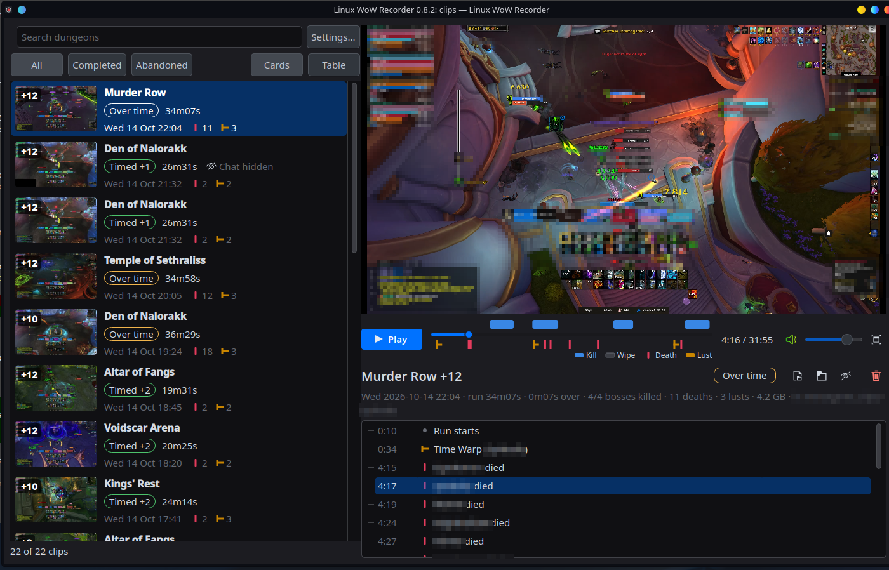

# Linux WoW Recorder

Records your World of Warcraft sessions on Linux and cuts one clip per dungeon run and per raid
boss pull, using WoW's combat log to find where each run starts and ends. Every clip comes with
its boss pulls, deaths and lusts, and a tray icon shows when it's recording.

**It runs entirely on your computer.** No account, no telemetry, no crash reporting. The only
network traffic it can make is a Discord or Fluxer message if you add a webhook, and a daily
check for a new version on GitHub if you turn that on. See [Privacy](#privacy).



**New in 1.0.0:** highlights: save part of a clip, such as one boss kill, as a clip of its own.
**0.8.6:** a `.deb` for Ubuntu and Debian, and a completed key is found even when combat
logging started late.
**0.8.4:** switching Settings to a window you pick opens the screen-share dialog again.
**0.8.3:** nothing starts at login unless you choose it: the recorder runs while the app
is open. **0.8.2:** completed keys say **Timed** (with the keystone upgrade, "Timed +2") or
**Over time**, and Settings can hide the parts of the clip browser you don't use. **0.8.0** brought
cutting about twice as fast, **Hide chat** (a copy of a clip with a black box over your chat), an
**Upload to YouTube** button, and **full screen** with the timeline still at the bottom.

**Docs:** [user guide](docs/user-guide.md) (install, setup, everyday use, troubleshooting) ·
[reference](docs/reference.md) (commands, every setting, file formats) ·
[development](docs/development.md) (how it works, the code, the rules for changes)

## What it does

```
WoW starts (found in /proc: Retail, Classic, PTR or beta, however it's installed)
  → gpu-screen-recorder records the session, using your GPU's encoder
WoW closes
  → the combat log is read for dungeon runs: each Mythic+ key from start to end (abandoned
    keys too, if they lasted 5 minutes), dungeons without a key from entering to leaving
    (if a boss was pulled), and each raid boss pull from pull to kill or wipe
  → one clip per run is cut out of the recording (no re-encode, takes seconds), named like
    "2026-10-08 19-03 Kings' Rest +12 Timed (24m52s).mp4", with a .json file beside it
    listing the boss pulls (kills and wipes), deaths, and each Bloodlust/Heroism/Time Warp/
    Primal Rage/Fury of the Aspects/drums
  → the full recording is kept for 3 days, then deleted
  → optional: a Discord or Fluxer message, and your own command run on the new clips
```

- **Records while the app is open.** Open Linux WoW Recorder, then launch the game however you
  like: Battle.net under Lutris, Heroic, Bottles, Faugus, Steam/Proton or plain Wine, Flatpak or
  not. It notices WoW starting and closing by itself. Nothing runs until you open the app, and
  Quit stops it. If you'd rather not think about it, Settings > Advanced can start it at every
  login instead. Either way it runs as you (a systemd user service), never as root.
- **Records only WoW's sound** by default, so Discord voice and music stay out of your clips.
  All desktop sound, your microphone, or no sound are options.
- **Records the whole screen, one monitor, or only the WoW window**, picked in your desktop's
  screen-share dialog, so notifications and other windows stay out of the video.
- **Desktop app (optional):** a tray icon (grey: waiting, red: recording, amber: cutting clips),
  a clip browser with a timeline of pulls, deaths and lusts (full screen too), and a settings
  window.
- **Hide chat:** when you ask, makes a copy of a clip with a black box over your chat, so you can
  share it without whispers or guild chat. Your clips are never changed.
- **Upload to YouTube:** one button copies a description with chapters (each boss pull, kill or
  wipe), opens YouTube's upload page in your browser and shows the clip to drag onto it.
- **Retail, Classic, PTR and beta**, and new WoW versions it doesn't know yet (it goes by the
  game's folder).

## Privacy

This app is built so you never have to wonder what it sends or where.

**What leaves your computer: nothing, unless you add a webhook or turn on update checks.**

- No telemetry, analytics, usage statistics or crash reporting. No account, no sign-in, no
  server of ours anywhere.
- The app can make **two** kinds of network connection, both your choice:
  - posting a message to the Discord or Fluxer webhooks you add in Settings (none by default);
  - asking GitHub, once a day, which version is newest. Setup asks whether you want this, and
    Settings > About turns it on or off. The request carries nothing about you or your computer:
    no version, settings or ID, just a plain request for the newest release's number. Like any
    web page, GitHub sees your IP address. If a newer version is out, the tray says so with a
    link; downloading and installing it is up to you. "Check now" in Settings > About asks once,
    even with daily checks off.

  With no webhooks and update checks off, it makes no connections at all.
- You choose which events send a message (see [below](#discord-or-fluxer-messages)). A message
  says what happened in plain words: a dungeon, key level, result, run length, bosses killed,
  how many deaths and lusts. **It never contains log lines, error output, file or folder paths,
  your computer's details, or anyone's character name.** When something goes wrong, the message
  says so and points to the log on your computer.
- Clips go nowhere unless you set up your own `after_clips` command (for example an `rsync` to
  your server), or upload one yourself.
- **The Upload to YouTube button doesn't upload anything.** It opens youtube.com/upload in your
  own web browser, copies a description to your clipboard and shows the clip in your file
  manager. The app makes no connection to YouTube or Google and never sees your account: you
  drag the clip onto the page and your browser does the upload, signed in as you. Nothing
  happens until you press the button, and you can close the page without uploading. The
  description has the dungeon, key level, result, length, date, death count and boss pulls; no
  character names.
- **Your chat can be in your clips.** WoW's chat is part of the picture, whispers and guild chat
  included. Before sharing a clip, Hide chat makes a copy with a black box over it, on your
  computer.

**What stays on your computer: everything else.**

| What | Where |
|---|---|
| Settings | `~/.config/linux-wow-recorder/config.toml` (only readable by you: webhook links are secrets) |
| Recordings and clips | the output folder you choose |
| Logs | `~/.local/state/linux-wow-recorder/logs/` |
| What the service is doing right now | `$XDG_RUNTIME_DIR/linux-wow-recorder/status.json` |

**Logs never leave your computer**, and they're written to be safe to share:

- Before a line is written, webhook links become `webhook 2 (...a1b2)`, your home folder becomes
  `~`, and your computer's name, your user name and IP addresses are replaced.
- They're capped: 1 MB per file with 4 old copies, the last 10 recording sessions, and anything
  untouched for 30 days is deleted.
- They're plain text, so you can read every line.

**Asking for help is your call.** Settings > Make a report file (or `linux-wow-recorder report`)
writes one text file, to a folder you pick, with your versions, settings and the end of the
logs, cleaned the same way and with your webhook links and `after_clips` command removed. Nothing
is sent: read it, then share it however and wherever you like, or don't.

**Check it yourself.** It's a small Python program, and it's all here:

- `grep -rn urlopen src/` finds the two places that open a connection:
  [`notify.py`](src/linux_wow_recorder/notify.py), which posts to your webhooks, and
  [`updates.py`](src/linux_wow_recorder/updates.py), which asks GitHub for the newest version.
- The test suite fails if any other file imports networking code, if `updates.py` contacts
  anything but GitHub's release API ([`tests/test_logs.py`](tests/test_logs.py)), or if a
  webhook message is built from log text or paths.
- The desktop app uses a local socket (`QLocalServer`, a file under `/run/user/`) so that opening
  it a second time brings the open window forward. It's on your computer only.

The programs it runs, gpu-screen-recorder and ffmpeg, run locally too. Updates for them and for
this app come from your package manager, when you choose.

## Requirements

- Linux with systemd (almost every desktop distro), on X11 or Wayland
- Python 3.11 or newer
- [gpu-screen-recorder](https://git.dec05eba.com/gpu-screen-recorder/about/) (from your distro
  or the Flatpak)
- ffmpeg (with ffprobe)
- **Combat logging on in dungeons.** WoW doesn't log by itself: type `/combatlog` once you're in,
  or let an addon do it (Raider.IO's client, or any auto combat logging addon). Turn on
  *Advanced Combat Logging* in WoW's Network settings too. Without a log, a session is still
  recorded but can't be cut into clips.

## Install

| Distro | How | Installs and sets up | Records |
|---|---|---|---|
| Nobara, Fedora | the RPM | yes (Nobara 44, Fedora 44) | yes (Nobara 44) |
| CachyOS, Arch, EndeavourOS, Manjaro | a package built from this repo (on the AUR soon), or `uv` | yes (CachyOS) | not yet |
| Ubuntu 25.10 and newer, Debian 13 | the `.deb` | yes (Ubuntu 26.04, Debian 13) | not yet |
| Bazzite, Fedora Atomic (Silverblue, Kinoite), Aurora | `uv`, into your home folder; no root, no reboot | yes (Bazzite) | not yet |
| SteamOS (Steam Deck) | `uv`, in Desktop Mode | its image has everything needed; not run | not yet |
| Ubuntu 24.04, Mint 22, Pop!_OS 24.04 | `uv` | yes (Pop!_OS 24.04 with COSMIC, Ubuntu 24.04) | not yet |
| openSUSE Tumbleweed | `uv`, with gpu-screen-recorder from openSUSE | yes (in a container) | not yet |
| others | `uv` | | not yet |

"Installs and sets up" was tried in virtual machines and containers, which have no graphics card
to record with. "Not yet" means it should work and hasn't been tried on a real PC. If you try
it, please say how it went in an issue.

### Fedora and Nobara

Download the `.rpm` from [Releases](../../releases), then:

```bash
sudo dnf install ./linux-wow-recorder-1.0.0-1.fc44.noarch.rpm
```

dnf brings in ffmpeg and Qt, and on Nobara gpu-screen-recorder too. Open **Linux WoW Recorder**
from the app menu; the settings window opens the first time. The RPM is built for one release
(`fc44` is Fedora/Nobara 44).

**Plain Fedora** doesn't have gpu-screen-recorder in its repos, so get its Flatpak (the settings
window finds it by itself):

```bash
flatpak remote-add --if-not-exists flathub https://dl.flathub.org/repo/flathub.flatpakrepo
flatpak install flathub com.dec05eba.gpu_screen_recorder
```

Fedora's own ffmpeg (`ffmpeg-free`) is enough. **Fedora Atomic** (Silverblue, Kinoite) is
read-only: use the Bazzite steps below instead of the RPM.

### CachyOS and Arch

```bash
sudo pacman -S --needed python ffmpeg uv gpu-screen-recorder
uv tool install 'linux-wow-recorder[gui] @ git+https://github.com/Visner-org/linux-wow-recorder'
linux-wow-recorder-gui
```

Or as a system package, so it updates with the rest of your system once it's on the AUR. Until
then, build it from this repo:

```bash
sudo pacman -S --needed git base-devel
git clone https://github.com/Visner-org/linux-wow-recorder
cd linux-wow-recorder/packaging/aur
makepkg -si
```

### Bazzite, Fedora Atomic, SteamOS and other read-only systems

Nothing is installed into the system: the app goes into `~/.local`, and gpu-screen-recorder
comes from Flathub.

```bash
flatpak remote-add --if-not-exists flathub https://dl.flathub.org/repo/flathub.flatpakrepo
flatpak install flathub com.dec05eba.gpu_screen_recorder
curl -LsSf https://astral.sh/uv/install.sh | sh   # installs uv into ~/.local/bin
uv tool install 'linux-wow-recorder[gui] @ git+https://github.com/Visner-org/linux-wow-recorder'
linux-wow-recorder-gui
```

The settings window finds the Flatpak by itself. Bazzite, Fedora Atomic and SteamOS ship
ffmpeg, git and Flatpak, so there's nothing else to add.

**Steam Deck:** install and play in Desktop Mode. Recording "the window or screen you pick" works
as is; recording the whole screen needs gpu-screen-recorder's helper, which asks for your
password, and the `deck` user has none until you set one with `passwd`. Game Mode isn't tried.

### Ubuntu and Debian (.deb)

For Ubuntu 25.10 and newer and Debian 13. Download the `.deb` from [Releases](../../releases),
then:

```bash
sudo apt install ./linux-wow-recorder_1.0.0-1_all.deb
flatpak remote-add --user --if-not-exists flathub https://dl.flathub.org/repo/flathub.flatpakrepo
flatpak install --user flathub com.dec05eba.gpu_screen_recorder
```

apt brings in ffmpeg, Qt and Flatpak. gpu-screen-recorder isn't in Ubuntu's or Debian's own
repositories, so it comes from Flathub; the settings window finds it by itself. Open **Linux WoW
Recorder** from the app menu.

### openSUSE Tumbleweed

openSUSE has gpu-screen-recorder, ffmpeg and Python in its own repos, so no Flatpak is needed:

```bash
sudo zypper install python313 ffmpeg gpu-screen-recorder git
curl -LsSf https://astral.sh/uv/install.sh | sh
```

Open a new terminal, then:

```bash
uv tool install 'linux-wow-recorder[gui] @ git+https://github.com/Visner-org/linux-wow-recorder'
linux-wow-recorder-gui
```

openSUSE's ffmpeg (like Fedora's) has only OpenH264 for H.264, which is enough. A native
openSUSE package doesn't exist yet.

### Ubuntu 24.04, Mint, Pop!_OS and others

Ubuntu 24.04 and the distros built on it (Mint 22, Pop!_OS 24.04) don't have the Qt packages
the `.deb` needs, so the app goes into your home folder with `uv`:

```bash
sudo apt install python3 ffmpeg flatpak      # or your distro's equivalent
flatpak remote-add --user --if-not-exists flathub https://dl.flathub.org/repo/flathub.flatpakrepo
flatpak install --user flathub com.dec05eba.gpu_screen_recorder
curl -LsSf https://astral.sh/uv/install.sh | sh   # or: pipx, see the user guide
```

Open a new terminal (so `~/.local/bin` is on your PATH), then:

```bash
uv tool install 'linux-wow-recorder[gui] @ git+https://github.com/Visner-org/linux-wow-recorder'
linux-wow-recorder-gui
```

**Without the desktop app**, leave out `[gui]` (it saves ~400 MB of Qt) and run
`linux-wow-recorder setup` instead: it asks the same questions in the terminal.

> **The command-line version starts at every login.** With no app to open, setup's last
> question installs the recorder as a background service that starts every time you log in
> and records whenever WoW runs. It runs as you, never as root.
> `linux-wow-recorder uninstall-service` stops that; or answer no and run
> `linux-wow-recorder run` in a terminal when you play.

### GPUs

NVIDIA, AMD and Intel all work through gpu-screen-recorder. On AMD and Intel under Wayland,
recording the whole screen needs gpu-screen-recorder's helper, which asks for your password
once. Recording through the screen-share dialog (the "window or screen you pick" option) never
does.

## Setting it up

The settings window (or `linux-wow-recorder setup`) asks for:

1. **Your combat log folder**: the `Logs` folder next to WoW's `_retail_` (or `_classic_`)
   folder, wherever your launcher put WoW.
2. **An output folder** for recordings and clips. A session takes a few GB per hour.
3. **What to record**: the whole screen, one monitor, or a window or screen you pick (choose the
   WoW window to record only WoW).
4. **Sound**: only WoW's (the default), all desktop sound, or none, and whether to add your
   microphone.
5. **Discord or Fluxer webhooks**: optional, and off until you add one.

Then record a 5-second test, and save. It records whenever the app is open; Settings > Advanced
can start it at every login instead.

KDE, COSMIC (Pop!_OS 24.04), Ubuntu's GNOME and most other desktops show tray icons as they
are. Stock GNOME (Fedora Workstation, Debian) needs the
[AppIndicator and KStatusNotifierItem Support](https://extensions.gnome.org/extension/615/appindicator-support/)
extension.

## Discord or Fluxer messages

Optional. Add up to 25 webhook links in Settings; every message goes to each one. Discord:
Server Settings > Integrations > Webhooks. Fluxer: the channel's or community's settings >
Webhooks. You choose which events send a message:

| Setting | Sent when | Default |
|---|---|---|
| `session_started` | WoW started and recording began | off |
| `session_ended` | WoW closed and the recording was saved | off |
| `clips_ready` | clips are ready: each run's dungeon, level, result, length, bosses killed, deaths and lusts | on |
| `no_runs` | a session ended with no dungeon runs or raid pulls in it | off |
| `no_combat_log` | no combat log covers a session (combat logging was off?) | on |
| `recording_failed` | the recorder didn't start, or stopped mid-session | on |
| `low_disk_space` | the output folder's drive is nearly full, or recording stopped because of it | on |
| `clip_failed` | a clip couldn't be cut | on |
| `hook_failed` | your `after_clips` command failed | on |
| `cleanup` | old recordings were deleted | off |

"On" only matters once you've added a webhook. Problem messages say what went wrong and point to
the log on your computer; they don't include the log.

## Sending clips somewhere

Moving clips anywhere is up to you. To do it automatically, set `after_clips` in Settings to a
command; it runs after each session with the new clips' paths as arguments. For example
`~/bin/upload-clips.sh` with:

```bash
#!/bin/sh
rsync -a --remove-source-files "$@" myserver:/srv/clips/
```

That moves the videos and leaves each clip's `.json` and `.jpg` behind. Add the folder they end
up in (on this computer: a second drive or a share you've mounted) to Settings > "Also show clips
from", and the clip browser still lists them with their deaths, lusts and bosses. See
[Keeping clips somewhere else](docs/user-guide.md#keeping-clips-somewhere-else).

## Commands

```bash
linux-wow-recorder setup               # (re)configure in the terminal
linux-wow-recorder status              # settings, service state, problems
linux-wow-recorder test-recorder       # record 5 seconds to <output>/test-recording.mkv
linux-wow-recorder test-webhooks       # a test message to every webhook
linux-wow-recorder process             # cut what's waiting now
linux-wow-recorder pause               # stop recording until WoW closes (resume: record again)
linux-wow-recorder keep <clip>...      # keep clips forever (--undo to let them expire)
linux-wow-recorder install-service     # start the recorder at EVERY LOGIN
linux-wow-recorder uninstall-service
linux-wow-recorder uninstall           # remove everything (Settings > Advanced > Uninstall... too)
linux-wow-recorder logs                # where the logs are, and the last lines
linux-wow-recorder report              # a report file to share by hand (nothing is sent)
```

Stopping the service mid-session saves the recording so far; it's cut after the next session.

## Getting help

Open an issue and describe what happened. If you want to include details, make a report file
(Settings > Make a report file, or `linux-wow-recorder report`), read it, and paste the parts
you're happy to share. Nobody can see your logs unless you share them.

## License

GPL-3.0-or-later: you can use, change and share it; versions you share must stay under the same
license, with their source. The full text is in [LICENSE](LICENSE).

## Development

```bash
uv sync --extra gui
uv run pytest
```

How it works, the code, the rules for logging and privacy, and what isn't done yet:
[docs/development.md](docs/development.md).
