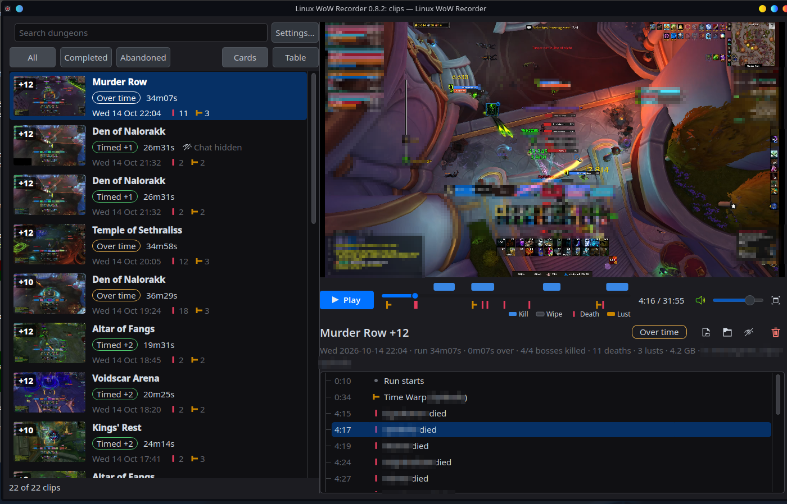

# Linux WoW Recorder

Records your World of Warcraft sessions on Linux and cuts one clip per dungeon run and per raid
boss pull, using WoW's combat log. Each clip comes with its boss pulls, deaths and lusts.

**Everything stays on your computer.** No account, no telemetry. See [Privacy](#privacy).



**New in 1.3:** Moments (short clips of your deaths, level-ups and elite kills), rules for
which Mythic+ keys get a clip, and a key's clip a minute or two after it ends. Older changes:
[Releases](../../releases).

**Docs:** [user guide](docs/user-guide.md) · [reference](docs/reference.md) ·
[development](docs/development.md)

## What it does

- **Notices WoW by itself**, however you launch it (Lutris, Heroic, Bottles, Steam/Proton, Wine),
  and records with [gpu-screen-recorder](https://git.dec05eba.com/gpu-screen-recorder/about/).
- **Cuts the clips itself**: each Mythic+ key a minute or two after it ends, each dungeon
  without a key and each raid boss pull when WoW closes. No re-encoding, so it takes seconds.
  Full recordings are deleted after 3 days.
- **Only WoW's sound** by default, so Discord and music stay out.
- **Only WoW's window** if you like, so notifications stay out.
- **Clip browser** with a timeline of pulls, deaths, lusts and casts; highlights, drawing on a
  frame, **Hide chat** (a copy with your chat blacked out) and a YouTube description with
  chapters.
- **Discord or Fluxer messages** (optional) when clips are ready or something goes wrong.
- Retail, Classic, PTR and beta. Runs as you, never as root.

## Privacy

- It connects to nothing, unless you add a webhook (Discord or Fluxer) or turn on the daily
  update check (asks GitHub for the newest version number, nothing else).
- Messages never contain logs, paths, computer details or character names.
- Logs stay on your computer, with your names, IPs and webhook links already blanked out.
  **Make a report file** writes a copy you can share yourself; nothing is sent.
- The YouTube button only opens youtube.com/upload in your browser. You do the upload.
- WoW's chat is in your clips. Use **Hide chat** before sharing.

Check it yourself: `grep -rn urlopen src/` finds the only two places that connect,
[`notify.py`](src/linux_wow_recorder/notify.py) and
[`updates.py`](src/linux_wow_recorder/updates.py). The tests fail if anything else does.

## Requirements

- Linux with systemd, on X11 or Wayland; Python 3.11+
- gpu-screen-recorder (distro package or Flatpak) and ffmpeg
- **Combat logging on in WoW** (`/combatlog`, or an auto-logging addon) with *Advanced Combat
  Logging* on. Without a log a session is recorded but not cut. There's also an
  [optional addon](docs/user-guide.md#the-wow-addon).

## Install

Recording is proven on Nobara 44. Other distros install and set up fine in VMs, but haven't
recorded on a real PC yet. If you try one, please say how it went in an issue.

**Nobara, Fedora 44:** download the `.rpm` from [Releases](../../releases), then

```bash
sudo dnf install ./linux-wow-recorder-1.3.3-4.fc44.noarch.rpm
```

On plain Fedora, also install the gpu-screen-recorder Flatpak (below).

**Ubuntu 25.10+, Debian 13:** download the `.deb` from [Releases](../../releases), then

```bash
sudo apt install ./linux-wow-recorder_1.3.3-4_all.deb
flatpak remote-add --user --if-not-exists flathub https://dl.flathub.org/repo/flathub.flatpakrepo
flatpak install --user flathub com.dec05eba.gpu_screen_recorder
```

**Arch, CachyOS:** build the package in `packaging/aur`:

```bash
sudo pacman -S --needed git base-devel
git clone https://github.com/Visner-org/linux-wow-recorder
cd linux-wow-recorder/packaging/aur && makepkg -si
```

**Everything else** (Bazzite, Fedora Atomic, SteamOS, Ubuntu 24.04, Mint, Pop!_OS, openSUSE):
install ffmpeg and gpu-screen-recorder (your distro's package, or the Flatpak above), then

```bash
curl -LsSf https://astral.sh/uv/install.sh | sh
uv tool install 'linux-wow-recorder[gui] @ git+https://github.com/Visner-org/linux-wow-recorder'
linux-wow-recorder-gui
```

Per-distro notes, the Steam Deck and running without the desktop app:
[user guide](docs/user-guide.md).

## Setting it up

Open **Linux WoW Recorder** from the app menu. The first time, it asks for your combat log
folder, an output folder (a few GB per hour), what to record and which sound, and optional
webhooks. Then record a 5-second test and save. It records while the app is open; Settings >
Advanced can start it at login instead.

Stock GNOME needs the
[AppIndicator](https://extensions.gnome.org/extension/615/appindicator-support/) extension for
the tray icon.

## Commands

```bash
linux-wow-recorder setup            # set up in the terminal
linux-wow-recorder status           # settings, service state, problems
linux-wow-recorder cut-now          # cut the clips so far while WoW runs
linux-wow-recorder report           # a report file to share by hand
```

All commands: [reference](docs/reference.md).

## Getting help

Open an issue. A report file (Settings > Make a report file) helps; read it first and share
what you're happy with.

## License

GPL-3.0-or-later. See [LICENSE](LICENSE).

Enemy forces counts are from [Mythic Dungeon Tools](https://github.com/Nnoggie/MythicDungeonTools)
by Nnoggie and its contributors. Thanks!

## Development

```bash
uv sync --extra gui
uv run pytest
```

How it works and the rules for changes: [docs/development.md](docs/development.md).
